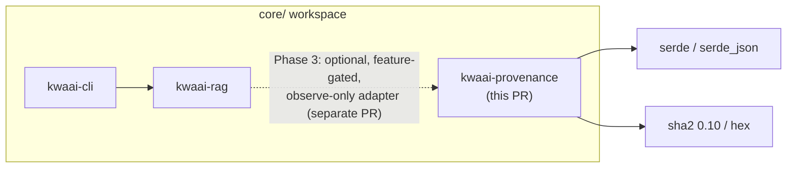
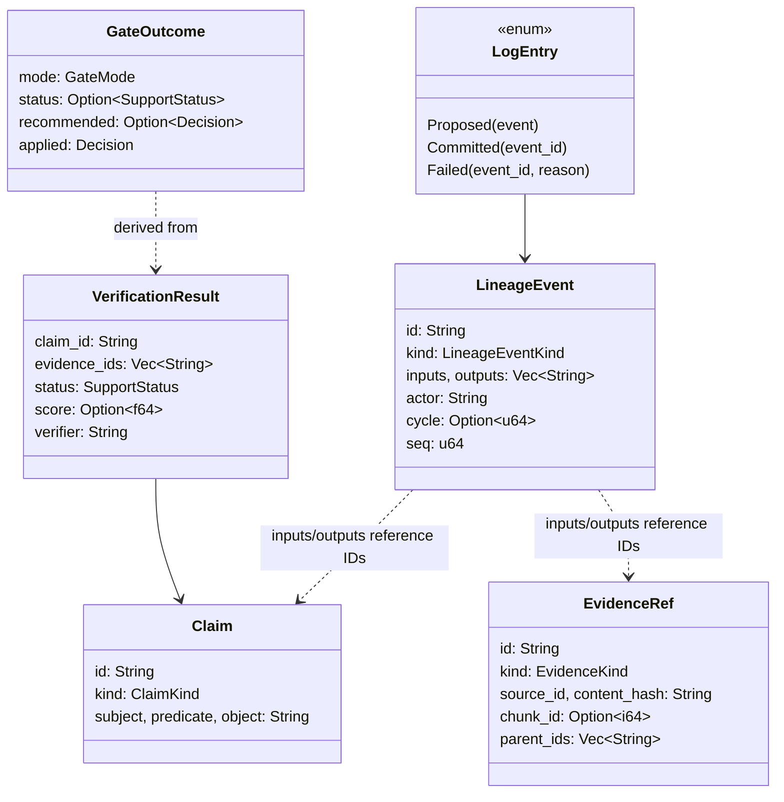
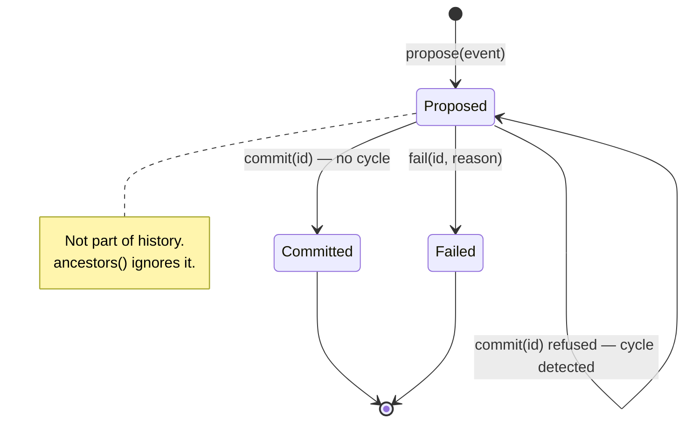
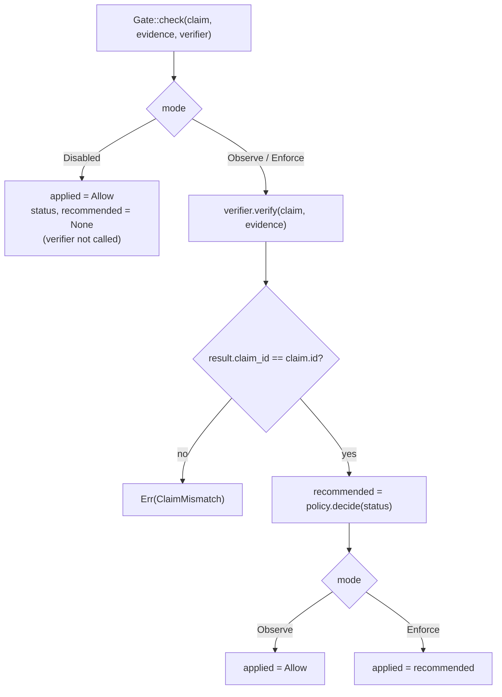
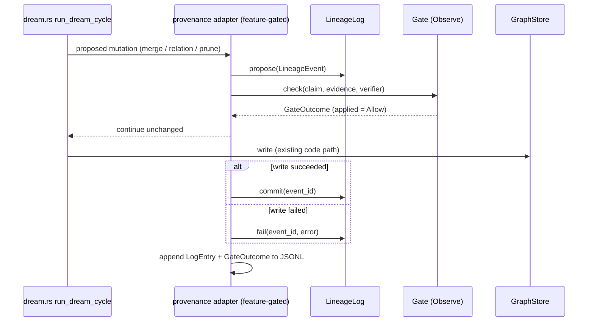

# Native Provenance — Plan and Requirements

**Author:** Jourdane Hamilton
**Crate:** `kwaai-provenance` (`core/crates/kwaai-provenance/`)
**Status:** Phase 1 (standalone primitives) is implemented and tested in this branch.
Phases 2–6 below are proposals and are not implemented.
**Related:** the DreamRAG second-cohort provenance claim — after N dream cycles, what
fraction of graph facts still trace to a source passage, and does gating before vs. after
consolidation leave fewer unsupported facts?

---

## 1. Context

The knowledge graph associates evidence with facts but does not record whether that
evidence *supports* them, or how a fact was derived. Three properties of the current
`kwaai-rag` code (verified against `main`; symbols, not line numbers):

| Where | What it does today | Why it matters for provenance |
|-------|-------------------|-------------------------------|
| `graph.rs` → `FieldValue` | `confidence = min(1.0, evidence_chunk_ids.len() / 3.0)` | Confidence measures evidence *count*, not semantic support. |
| `dream.rs` → `run_dream_cycle`, relation completion | A dream-added relation takes **all** of the source entity's chunks (`chunks_for_entity`), and falls back to chunk `0` when the entity has none. | Inherited or placeholder chunk IDs look like evidence but are not evidence that the relation is true. |
| `retriever.rs` → `RetrievedChunk.chunk_id: Option<i64>` | `None` marks synthetic results (fact cards, summaries). | Derived content must not be mistaken for an original passage. |

There is also no record of *transformations*: once a dream cycle merges, rewrites or
prunes, the path from a current fact back to its source passage is lost.

## 2. Goals and non-goals

**Goals**

1. Give claims and evidence deterministic, content-derived identities.
2. Record derivations (extract, derive, merge, rewrite, prune) as immutable lineage
   events, with proposed / committed / failed kept distinct.
3. Answer "does this fact still trace to original evidence?" and compute that rate
   across a set of facts — the metric the provenance claim needs.
4. Separate *verification status* (supported / unsupported / unresolved) from the
   *policy decision* (allow / reject / quarantine), with Disabled, Observe and Enforce
   modes that share one verification path.
5. Preserve baseline KwaaiNet behaviour exactly until a later, separately reviewed PR
   opts in.

**Non-goals for this PR**

- Any change to `kwaai-rag`, `kwaai-cli`, or the dream loop.
- Semantic verification (NLI, LLM judge). Only a stub verifier ships.
- Persistence, snapshots, or a durable quarantine store.
- Replacing the Python provenance harness used for research; it stays a separate control.

## 3. Requirements

Functional requirements are numbered so the test plan (§8) can trace them.

| ID | Requirement |
|----|-------------|
| FR-1 | Identical claims (kind, subject, predicate, object) get identical IDs; any difference, including kind, changes the ID. |
| FR-2 | Evidence IDs are deterministic and change when the content version (hash) changes. |
| FR-3 | Hash encoding is length-prefixed and domain-separated, so concatenation cannot collide. |
| FR-4 | A lineage event's ID covers kind, inputs, outputs, actor, cycle and sequence; input/output order and duplicates do not change it; mutation state is excluded. |
| FR-5 | Malformed events are rejected: no inputs; no outputs (except prune); prune with outputs; empty IDs; self-derivation; non-canonical lists; stored ID ≠ recomputed ID. |
| FR-6 | Only committed events contribute to ancestry. Proposed and failed events never do. |
| FR-7 | State transitions are one-way (proposed → committed or failed); duplicates and unknown IDs are errors. |
| FR-8 | A commit that would make an artifact its own ancestor is refused and leaves the event proposed. |
| FR-9 | An artifact may have several derivation paths; all are retained. |
| FR-10 | Ancestry, roots and "traces to original" are queryable. Lineage that ends at a synthetic or unknown artifact is not traceable. |
| FR-11 | Prune is recorded without erasing the pruned artifact's lineage. |
| FR-12 | A traceability rate over a set of artifacts is computable; an empty set yields no value rather than 0 or 1. |
| FR-13 | Log entries and gate outcomes serialize to single-line JSON (JSONL) and round-trip. |
| FR-14 | Disabled mode never calls the verifier and always allows. |
| FR-15 | Observe mode calls the verifier, records the policy recommendation, and always allows. |
| FR-16 | Enforce mode applies the policy. Default: Supported → Allow, Unsupported → Reject, Unresolved → Quarantine. The mapping is configurable. |
| FR-17 | Observe and Enforce produce the same status and recommendation for the same input. |
| FR-18 | A verifier result for a different claim is an error, not a decision. |
| FR-19 | No bundled verifier reports Supported; evidence association alone never yields Supported. |

| ID | Non-functional requirement |
|----|----------------------------|
| NFR-1 | The crate does not depend on `kwaai-rag` or any other KwaaiNet crate. |
| NFR-2 | Deterministic: ordered collections throughout; no clocks, randomness or I/O. |
| NFR-3 | No `unsafe`, no network, no filesystem access. |
| NFR-4 | Every public item is documented; the crate-level example compiles as a doctest. |
| NFR-5 | Passes the repository CI gates: fmt, clippy `-D warnings`, tests on all platforms, Windows `cargo check`, memory integrity, orphaned docs. |
| NFR-6 | Not published to crates.io (`publish = false`) while experimental. |

## 4. Design

### 4.1 Where it sits

`kwaai-provenance` depends only on serialization and hashing crates. Nothing in the
workspace depends on it yet, so this PR cannot change runtime behaviour.

### 4.2 Data model

### 4.3 Mutation lifecycle

Each transition is a new `LogEntry`; nothing is edited in place. The event ID excludes
state, so the same event is identifiable across all three entries.

### 4.4 Gate decision

`GateOutcome::would_block()` reports whether Enforce would have changed the outcome,
which is the observation signal for measuring false rejections before anything is enforced.

### 4.5 Proposed integration (Phase 3, not in this PR)

In Observe mode the adapter only records. The dream loop's mutations, order and results
are unchanged, which is what makes a baseline-vs-observe comparison valid.

## 5. Decisions

**D0 — A new crate, not a module in `kwaai-rag`.** The point of provenance is to
judge what the pipeline produced, so it should not live inside the pipeline. A
separate crate keeps the evaluation baseline clean (nothing in `kwaai-rag` changes
until the Phase 3 adapter), can be reviewed and tested on its own, and keeps the
dependency one-way: `kwaai-rag` may depend on it later, never the reverse. The cost
is one more workspace member and an adapter to write.
*Rejected:* a `provenance` module inside `kwaai-rag` — smaller today, but it puts
the measuring code inside the system being measured, and the Phase 3 diff becomes
harder to separate from baseline behaviour.

**D1 — Lineage identity is separate from artifact identity.** Evidence and claim IDs
identify *what* an artifact is; lineage events record *how* it was derived. The same
artifact can be reached by several derivations without changing its ID.
`EvidenceRef.parent_ids` is kept for compatibility but is informational and is not read
by the lineage log; the log is the authoritative derivation record.
*Rejected:* hashing parents into the evidence ID — it makes identical content reached
two ways look like two artifacts.

**D2 — State is not part of the event ID.** A proposal and its commit refer to one ID.
Commit and failure are appended entries, so the log is append-only and a failed graph
write can never appear as history.

**D3 — Entity merges and claim rewrites are distinct event kinds.** Merging two graph
entities is not evidence that any claim about them is supported.

**D4 — Status and decision are separate types.** Verifiers produce a `SupportStatus`;
`Policy` maps it to a `Decision`. Changing policy never requires re-verifying.

**D5 — One verification path for Observe and Enforce.** Observation results are only
predictive of enforcement if both modes run the same code.

**D6 — The bundled verifier is `UnresolvedVerifier`.** It cannot be mistaken for a
real one. Enforce mode with it quarantines everything, which is the safe failure.

**D7 — Local hashing in `lineage.rs`.** The module uses its own length-prefixed SHA-256
helper with a distinct domain (`kwaai-provenance:lineage-event:v1`) rather than coupling
to `identity::hash_parts`, so either can change without silently changing the other's IDs.

**D8 — `sha2` 0.10.** Same major as `kwaai-rag`, so the workspace compiles one `sha2`.

**Vocabulary.** *Lineage event*, *traceability* and *provenance gate* are defined in
`GLOSSARY.md` §6. The provenance gate decides whether a proposed graph mutation is
applied; it is distinct from the glossary's *consolidation gate (proposed)*, which decides
when a chunk becomes evictable. A future consolidation gate could use this crate's
traceability queries as one input.

## 6. Compatibility and baseline behaviour

- No existing crate's source changes. The workspace change is one line in
  `core/Cargo.toml` (`members`) plus the resulting `Cargo.lock` entries.
- No crate depends on `kwaai-provenance`, so the `kwaainet` binary is unchanged.
- `publish = false`; the crate is absent from the publish list in
  `.github/workflows/publish-crates.yml`.
- Rollback: revert the PR. Nothing else references the crate.

## 7. Security and data-handling considerations

- **IDs are integrity checks, not authentication.** SHA-256 IDs detect accidental
  corruption and tampering that does not recompute the hash. Anyone can construct a
  well-formed event with a valid ID; there are no keys or signatures. Signed lineage
  would need `kwaai-trust`.
- **Resource use.** The log is in memory and unbounded. `ancestors()` is a graph walk;
  `commit()` walks each input's ancestry for cycle detection. Fine for experiments,
  not yet bounded for production-sized graphs.
- **Byte-exact identity.** No normalization: `Alice` and `alice` are different claims.
  This avoids silent merges but can split one fact into several IDs.
- **Private corpora.** Claim text and JSONL observation logs contain knowledge-base
  content. Logs produced from a private KB (D6) must follow the same rule as D6 itself:
  never committed to this repository.
- No `unsafe`, network, filesystem, or deserialization of untrusted input in a
  network-facing path.

## 8. Test plan

Run from `core/`: `cargo test -p kwaai-provenance`. 28 tests: 6 identity, 13 lineage,
8 gate, 1 doctest.

| Requirement | Test(s) |
|-------------|---------|
| FR-1 | `identity::tests::identical_claims_have_identical_ids`, `different_claims_have_different_ids`, `claim_kinds_are_distinct` |
| FR-2 | `identity::tests::evidence_identity_is_deterministic`, `evidence_versions_have_different_ids` |
| FR-3 | `identity::tests::hash_encoding_is_unambiguous`, `lineage::tests::event_id_separates_kind_actor_cycle_seq_and_framing` |
| FR-4 | `lineage::tests::event_id_is_order_independent_and_deterministic`, `event_id_separates_kind_actor_cycle_seq_and_framing` |
| FR-5 | `lineage::tests::shape_validation`, `tampered_or_noncanonical_record_fails_validation` |
| FR-6 | `lineage::tests::proposed_and_failed_events_do_not_enter_history`, crate doctest |
| FR-7 | `lineage::tests::state_transitions_are_one_way` |
| FR-8 | `lineage::tests::commit_rejects_cycles` |
| FR-9 | `lineage::tests::multiple_derivation_paths_to_same_artifact` |
| FR-10 | `lineage::tests::ancestry_through_merge_and_rewrite_reaches_original`, `lineage_that_stops_at_synthetic_input_is_not_traceable` |
| FR-11 | `lineage::tests::prune_is_recorded_without_erasing_history` |
| FR-12 | `lineage::tests::traceability_rate` |
| FR-13 | `lineage::tests::log_entries_round_trip_as_jsonl`, `gate::tests::outcome_serializes_to_jsonl` |
| FR-14 | `gate::tests::disabled_skips_verifier_and_allows` |
| FR-15 | `gate::tests::observe_records_but_never_blocks` |
| FR-16 | `gate::tests::enforce_applies_default_policy`, `custom_policy` |
| FR-17 | `gate::tests::observe_and_enforce_agree_on_recommendation` |
| FR-18 | `gate::tests::verifier_claim_mismatch_is_an_error` |
| FR-19 | `gate::tests::stub_verifier_never_reports_support` |
| NFR-1 | `cargo tree -p kwaai-provenance` shows no KwaaiNet crate |
| NFR-4 | crate doctest; `RUSTDOCFLAGS="-D warnings" cargo doc -p kwaai-provenance --no-deps` |
| NFR-5 | CI on the PR |

**What these tests do not show:** semantic correctness of any verifier, behaviour on
real dream-cycle data, performance at graph scale, or Rust/Python parity. Those belong to
Phases 3–6.

## 9. Limitations

1. No persistence or snapshots; the log lives only in memory.
2. No semantic verifier. Enforce mode with the stub quarantines every claim.
3. Quarantine is a decision value only; there is no quarantine store or review flow.
4. Claim IDs carry no tenant / knowledge-base namespace.
5. No string normalization policy (case, whitespace, Unicode).
6. `EvidenceRef` constructors take `content_hash` from the caller and do not compute or
   check it; deserialized `Claim`/`EvidenceRef` records are not checked against their IDs.
   (Deserialized `LineageEvent`s are, via `validate()`.)
7. Artifact IDs in lineage events are opaque strings; the log does not know whether an ID
   is a claim, evidence or entity. Callers supply `is_original`.
8. Unbounded memory and unbounded graph walks (§7).

## 10. Rollout

| Phase | Scope | State |
|-------|-------|-------|
| 1 | Standalone primitives: identity, lineage log, gate, docs | **This PR** |
| 2 | Persistence: append-only JSONL writer/reader for `LogEntry` and `GateOutcome`, validating every event on read; snapshots | Proposed |
| 3 | Observe-only adapter in `kwaai-rag` behind a cargo feature, default off; separate PR; no change to mutations | Proposed |
| 4 | Real verifier(s) behind the `Verifier` trait; calibration against labelled data | Proposed |
| 5 | Enforce mode and a durable quarantine store | Proposed |
| 6 | Evaluation: traceability after N cycles, unsupported-fact rate, false-rejection rate, recall@k cost of gating, gate-before vs. gate-after consolidation, Rust/Python parity, reproducible JSONL artifacts | Proposed |

Each phase is its own PR. Enforcement (Phase 5) is not proposed until Observe data from
Phase 3 shows the false-rejection rate.

## 11. Open questions

1. **Namespace.** Should claim IDs include the KB's `tenant_id`? Doing so is a schema
   version bump (v2) and changes every ID.
2. **Normalization.** Should claim identity follow the graph's name normalization
   (`find_by_name_normalized`), or stay byte-exact and leave merging to lineage events?
3. **Chunk `0` fallback.** In Phase 3, should a dream relation whose evidence is the
   placeholder `0` be recorded as derived from a synthetic artifact (untraceable), or
   skipped?
4. **Entity IDs.** The glossary notes entity type is part of the entity ID hash. When a
   dream cycle reclassifies a type, is that an `EntityMerge` or a new event kind?
5. **Sequence numbers.** Who assigns `seq` in Phase 3 — the adapter (per cycle) or the
   graph store?
6. **Log location.** Under the KB directory beside the graph, or a separate experiment
   output directory?
