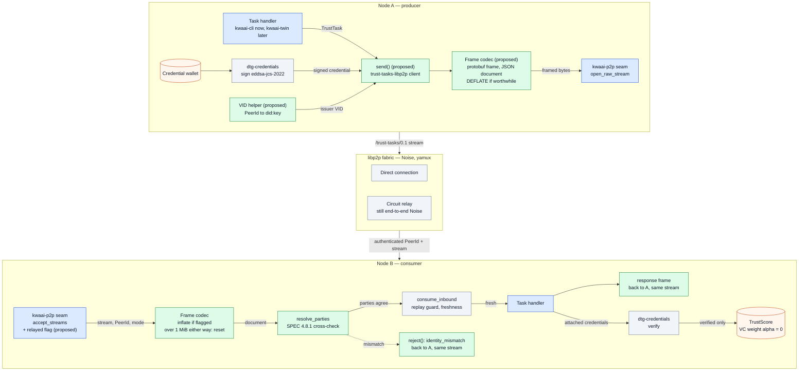
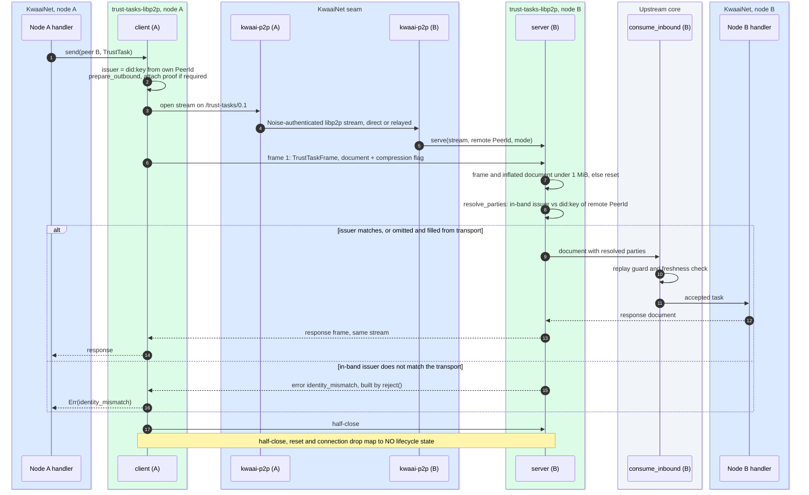
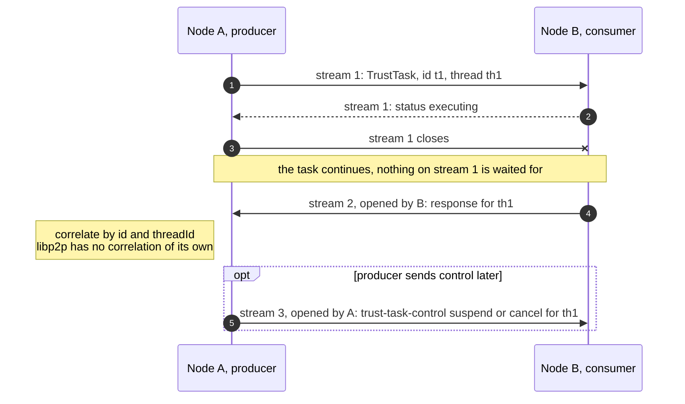
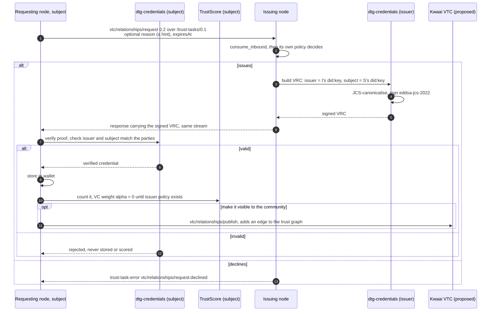
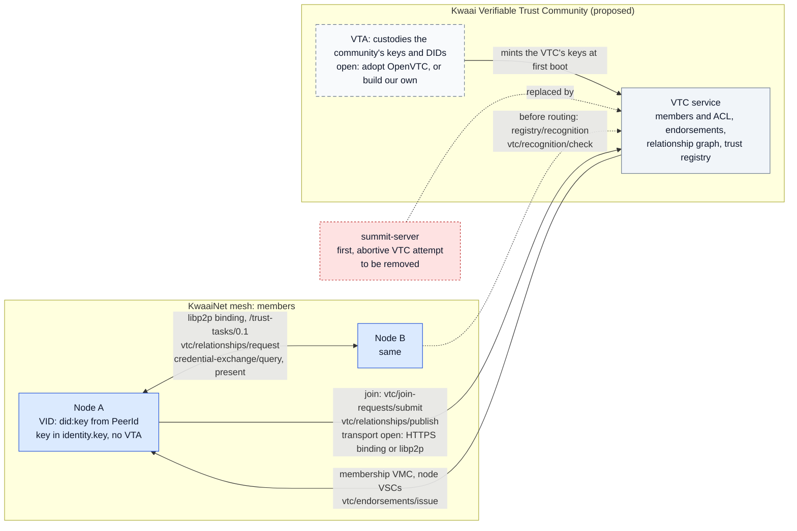

# DTGWG trust stack — design diagrams

Diagrams for [`plans/DTGWG-TrustStack-plan.md`](../plans/DTGWG-TrustStack-plan.md). They
show the **target state after Phase 3 (Q1 2027)**. Names marked *(proposed)* do not exist
yet in any codebase; everything else exists today in KwaaiNet `main` or in upstream
`trustoverip/dtgwg-trust-tasks-tf` (`trust-tasks-rs` 0.31.1, `15b91d1f`, read 2026-10-14).
Diagrams 2, 5 and 6 carry the 2026-10-14 decisions: KwaaiNet becomes a Verifiable Trust
Community (VTC), and the first Trust Task is peer endorsement via upstream's
`vtc/relationships/request`. Dashed outlines mark what is still open.

PNG renderings live in [`img/dtgwg-trust-stack/`](img/dtgwg-trust-stack/) for the plan's
narrative. **The Mermaid below is the source of truth**; after changing it, regenerate the
PNGs (each block saved as a `.mmd`, then
`mmdc -i <name>.mmd -o img/dtgwg-trust-stack/<name>.png -b white -s 2 -w 1600`)
in the same commit, or they go stale.

Ownership is the point of the design, so every diagram keeps it visible:

| Colour | Owner | Changes when Trust Tasks changes? |
|---|---|---|
| Blue | KwaaiNet tree | **No** — only the `(PeerId, stream)` seam lives here |
| Green | `trust-tasks-libp2p` — contributed by Kwaai, in the upstream workspace, co-maintained | Yes, carried by upstream's lockstep releases |
| Grey | Upstream core (`trust-tasks-rs`) and third-party crates and services (OpenVTC, Affinidi) | Their releases |
| Dashed | An open decision (diagram 6: the VTA) | — |
| Red, dashed | Being retired (`summit-server`) | — |

## 1. Data flow — one Trust Task between two nodes

What crosses the KwaaiNet seam is only a stream, a `PeerId` and a direct/relayed flag.
The Trust Task document, its parties, framing, the replay guard and the VID mapping all
live in the contributed crate (green) or upstream (grey). That is why an upstream release
does not touch our code.

## 2. Entity relationships

```mermaid
erDiagram
    NODE ||--|| VID : "derives deterministically"
    NODE ||--o| ROUTING_DID : "optionally publishes"
    NODE ||--o{ SIGNED_PEER_RECORD : "announces"
    NODE ||--|| WALLET : "keeps"
    NODE ||--o{ PEER_REPUTATION : "observes peers"
    VID ||--o{ TRUST_TASK : "issues"
    VID ||--o{ TRUST_TASK : "receives"
    TRUST_TASK }o--|| THREAD : "belongs to"
    TRUST_TASK ||--|| FRAME : "carried in"
    FRAME }o--|| BINDING : "defined by"
    TRUST_TASK |o--o{ DTG_CREDENTIAL : "binds via taskContext"
    WALLET ||--o{ DTG_CREDENTIAL : "holds"
    WALLET ||--o{ LEGACY_VC : "keeps read-only"
    VID ||--o{ DTG_CREDENTIAL : "issues"
    VID ||--o{ DTG_CREDENTIAL : "is subject of"
    DTG_CREDENTIAL ||--|| DATA_INTEGRITY_PROOF : "signed by"
    DTG_CREDENTIAL }o--o| VSC_PREDICATE : "states, if VSC"
    DTG_CREDENTIAL }o--o{ TRUST_SCORE : "counts toward once verified"
    NODE }o--o| COMMUNITY : "is a member of"
    COMMUNITY ||--o| VTA : "keys held by (open)"
    COMMUNITY ||--o{ DTG_CREDENTIAL : "issues VMC and VSC"
    COMMUNITY ||--o{ DTG_CREDENTIAL : "publishes VRCs in its graph"

    NODE {
        string peer_id PK "libp2p PeerId, Noise-authenticated"
        bytes public_key "identity multihash: Ed25519, secp256k1 or ECDSA"
    }
    VID {
        string did_key PK "did:key, compared by exact string"
    }
    ROUTING_DID {
        string did_peer_2 PK "did:peer:2, keys plus service endpoint"
        string multiaddrs "for the TSP bridge"
    }
    SIGNED_PEER_RECORD {
        bytes envelope "libp2p signed peer record"
        string addrs "at most 4 dialable"
    }
    TRUST_TASK {
        string id PK
        string type_uri "trusttasks.org spec URI"
        string issuer FK "VID"
        string recipient FK "VID"
        string thread_id FK
        json payload
        json proof "optional"
    }
    THREAD {
        string thread_id PK "correlates follow-up streams"
        string state "lifecycle per SPEC 4.12 and 11"
    }
    FRAME {
        bytes document "UTF-8 JSON, possibly compressed"
        string compression "NONE or DEFLATE"
        int max_bytes "1 MiB, framed and inflated"
    }
    BINDING {
        string binding_uri PK "trusttasks.org binding libp2p 0.1"
        string protocol_id "/trust-tasks/0.1 (proposed)"
        string mode "direct or relayed"
    }
    DTG_CREDENTIAL {
        string id PK
        string subtype "VMC VRC VDC VIC VPC VSC VAC"
        string issuer FK "VID"
        string subject FK "VID"
        string issuer_scope "pairwise directed or public"
        datetime valid_from
        string task_digest_multibase "optional"
    }
    DATA_INTEGRITY_PROOF {
        string cryptosuite "eddsa-jcs-2022"
        string verification_method
        string proof_value
    }
    VSC_PREDICATE {
        string iri PK "Kwaai-namespaced, accept-listed"
        bool on_accept_list
    }
    LEGACY_VC {
        string type "pre-DTG Kwaai VC types"
        string note "not reliably verifiable, never scored"
    }
    WALLET {
        string path "under KWAAINET_HOME"
    }
    TRUST_SCORE {
        float score
        string tier "Unknown Known Verified Trusted"
    }
    COMMUNITY {
        string did PK "the Kwaai VTC's DID (proposed)"
        string registry "trust registry for recognition checks"
    }
    VTA {
        string did PK "custodies the community's keys"
        string status "open: required under OpenVTC"
    }
    PEER_REPUTATION {
        string peer_id FK
        string observations "availability, throughput, latency"
    }
```

Mapping of today's credential types to DTG subtypes (from the plan):

| Today | DTG credential | Notes |
|---|---|---|
| PeerEndorsementVC | **VRC** | Delivered by `vtc/relationships/request` (diagram 5); was VSC `endorses/1` until 2026-10-14 |
| UptimeVC, ThroughputVC | VSC, Kwaai-namespaced predicate | `witnessed/1` needs a `taskContext`; ours are self-measured |
| FiduciaryPledgeVC | VSC | |
| SummitAttendeeVC | VMC, `issuerScope: public` | Issued by the Kwaai VTC in place of summit-server |
| VerifiedNodeVC | VMC | Issued by the Kwaai VTC (`vtc/endorsements/issue`) |
| BindingVC | VDC grant/accept | summit-server, the old issuer, is replaced by the VTC |

## 3. Sequence — request, response, and a rejected sender

## 4. Sequence — late response on a fresh stream

## 5. Sequence — peer endorsement, the first Trust Task

Upstream's `vtc/relationships/request` 0.2, used unchanged: the requesting member asks, the
issuing member decides, and the signed VRC comes back in the response.

## 6. KwaaiNet as a Verifiable Trust Community

Decided 2026-10-14. Node-to-node tasks ride our libp2p binding; tasks with the community
go to the VTC. In OpenVTC's reference implementation every VTC sits on top of a VTA, so
whether we need one, and whose, is the open question (dashed).

Open questions this diagram leaves visible: does the community need a VTA (yes, if we adopt
OpenVTC); does any node need one (proposed: no); where the VTC runs and who operates it;
whether nodes reach it over HTTPS or libp2p; and whether a node joins with its public
`did:key` or a pairwise identifier, which `vtc/join-requests/submit` expects.
